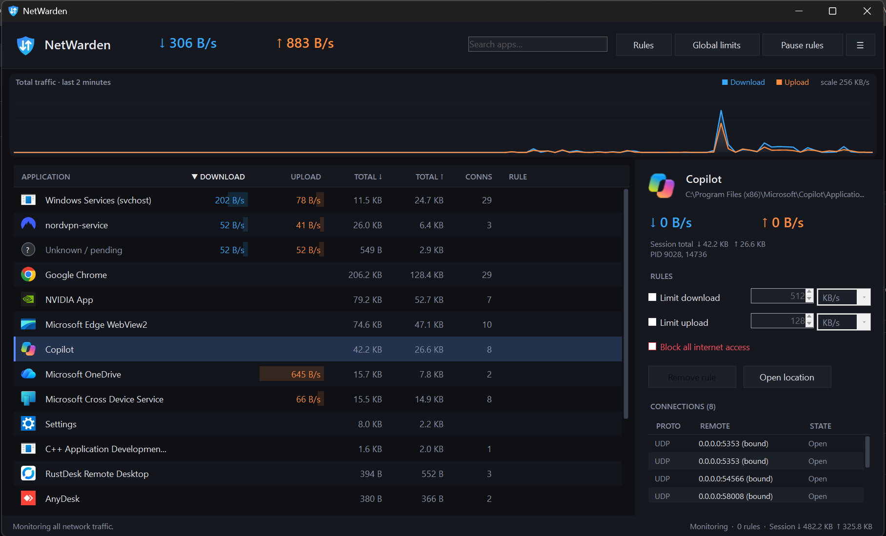
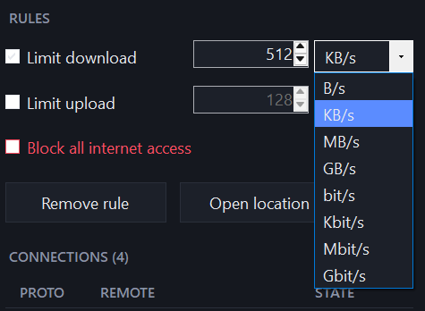
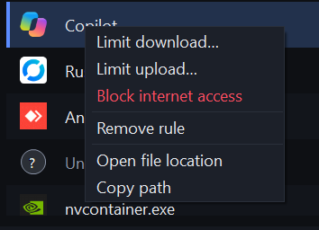
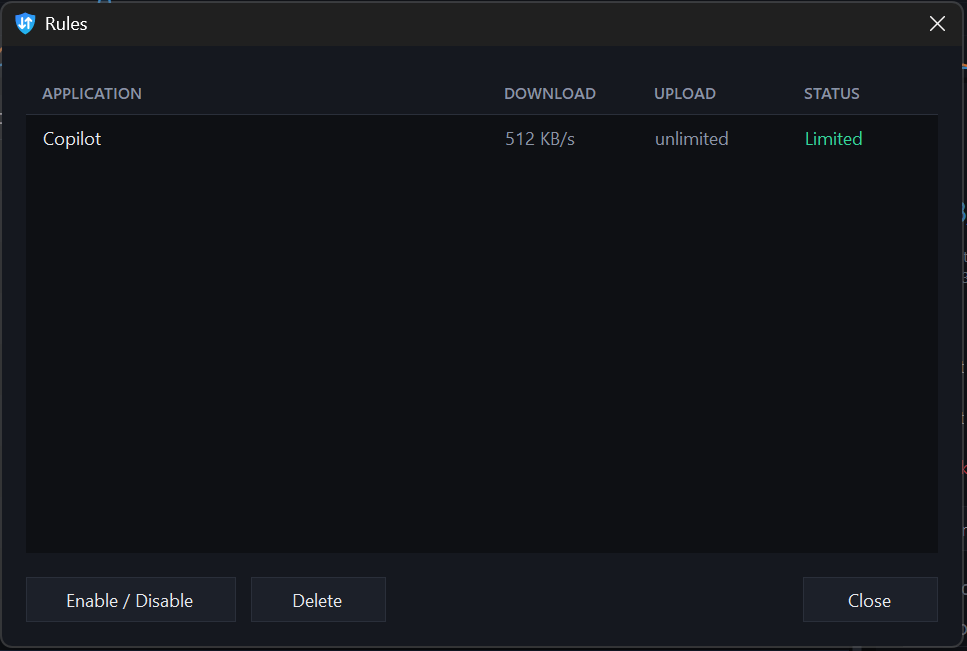

<div align="center">


# NetWarden

**A lightweight, NetLimiter-style bandwidth monitor, limiter and app firewall for Windows 11.**

See which apps use your internet, cap their speed, or block them — from a single ~260 KB portable EXE.

[](https://github.com/hansonds/NetWarden/releases/latest)
[](https://github.com/hansonds/NetWarden/actions/workflows/build.yml)


</div>

---

## ✨ Features

| | |
|---|---|
| 📊 **Live per-app traffic** | Download / upload speed, session totals and open connections for every program, with activity bars and a 2-minute traffic graph. |
| 🐢 **Per-app speed limits** | Cap the download and/or upload speed of any app. Limits are smooth and accurate (within ~2%) because traffic is *delayed*, not just dropped. |
| 📏 **Any unit you like** | B/s, KB/s, MB/s, GB/s, bit/s, Kbit/s, Mbit/s, Gbit/s — default KB/s. Each rule remembers its unit. |
| ⛔ **Block apps** | Cut any program off from the internet with one click. |
| 🌐 **Global limits** | Cap the total speed of the whole PC — works together with per-app limits. |
| 📶 **Mobile Hotspot aware** | Traffic used by phones/PCs connected to your Windows Mobile Hotspot shows up as its own entry — and can be limited or blocked too. |
| 🔌 **Connections view** | See each app's TCP/UDP connections, remote addresses and states. |
| 💾 **Rules remembered** | Limits and blocks are saved and re-applied automatically, even for apps you start later. |
| ⏸️ **Pause all rules** | One click to turn every limit off (and back on). |
| 🖥️ **Tray & autostart** | Lives in the system tray with live speeds in the tooltip. Optional *Start with Windows* (no UAC prompt at logon). |
| 🪶 **Lightweight** | One tiny EXE, no installer, no background service. Uses the .NET Framework already built into Windows. |

---

## 📸 Screenshots

<table>
<tr>
<td width="50%"><br><sub><b>App details</b> — live speed, limits, block and connections</sub></td>
<td width="50%"><br><sub><b>Unit picker</b> — set limits in KB/s, MB/s, Mbit/s and more</sub></td>
</tr>
<tr>
<td width="50%"><br><sub><b>Right-click menu</b> — quick limit, block, open file location</sub></td>
<td width="50%"><br><sub><b>Rules</b> — enable, disable or delete saved rules</sub></td>
</tr>
</table>

---

## 📥 Download & run

1. Go to **[Releases](https://github.com/hansonds/NetWarden/releases/latest)** and download `NetWarden-vX.X.X.zip`.
2. Extract it anywhere (e.g. `C:\Tools\NetWarden`).
3. Run **`NetWarden.exe`** and click **Yes** on the administrator prompt.

That's it — no installation.

> **Requirements:** Windows 10 or 11, 64-bit (Intel/AMD). Administrator rights.
> ARM-based Windows PCs are not supported.

---

## 🚀 How to use

**Limit an app**
1. Click the app in the list.
2. On the right, tick **Limit download** and/or **Limit upload**.
3. Type a number and pick a unit — the limit applies instantly.

**Block an app** — tick **Block all internet access** (or right-click → *Block internet access*).

**Limit the whole PC** — click **Global limits** at the top.

**Manage rules** — the **Rules** button lists every rule; **Pause rules** turns them all off temporarily.

**Hotspot devices** — turn on Windows *Mobile Hotspot*; connected devices appear as **Mobile Hotspot** and can be limited like any app.

**Settings (☰ menu)** — Start with Windows, minimize to tray on close, show idle apps, reset counters.

> 💡 Switching units keeps the same real speed: 512 KB/s → 0.5 MB/s.
> Byte units use 1024 (1 MB/s = 1024 KB/s); bit units use 1000, like internet plans (10 Mbit/s = 1.25 MB/s).

---

## ⚙️ How it works

NetWarden uses **[WinDivert](https://github.com/basil00/WinDivert)**, a signed, open-source Windows packet driver.

- **Monitoring only** (no rules active): NetWarden just *watches a copy* of the traffic — zero added latency.
- **Limits/blocks active**: packets of the affected apps go through a token-bucket shaper that smoothly delays them to the set speed.
- Traffic is matched to apps using Windows' own connection tables, so names, icons and paths are exact.
- The driver is embedded in the EXE, loaded only while NetWarden runs, and unloaded when it exits. If NetWarden closes or crashes, your internet keeps working normally.

Settings are stored in `%AppData%\NetWarden\config.json`.

---

## ❓ FAQ

<details>
<summary><b>Why does it need administrator rights?</b></summary>

Seeing and controlling network traffic requires a kernel driver, and Windows only lets administrators load drivers.
</details>

<details>
<summary><b>My antivirus warns about WinDivert.</b></summary>

Some antivirus tools flag WinDivert as a generic "network tool" because it can intercept traffic. It's a well-known, signed open-source driver used by many projects. Add an exception if needed.
</details>

<details>
<summary><b>What is "Unknown / pending"?</b></summary>

Brand-new connections for a second or two before Windows reports which app owns them, plus a little traffic handled by drivers (e.g. some VPNs) rather than programs.
</details>

<details>
<summary><b>Does it limit traffic between apps on the same PC?</b></summary>

No — local (localhost) traffic is ignored; only real network traffic is counted and limited.
</details>

---

## 🛠️ Build from source

The app is C# (WinForms, .NET Framework 4.8) with no external dependencies.

**On GitHub (no software needed):** go to **Actions → Build NetWarden → Run workflow**.
The finished `NetWarden.exe` appears under *Artifacts* on the run page. Tick *Also publish a GitHub Release* to publish it to Releases automatically. The version number comes from `src/Program.cs`.

**Windows** (Visual Studio 2022 or .NET SDK):
```
dotnet build src/NetWarden.csproj -c Release
```

**Linux** (cross-build): `build/build.sh` — uses the .NET SDK's C# compiler with Mono's .NET Framework reference assemblies.

```
.github/workflows/build.yml   GitHub Actions build
src/
├── Program.cs     startup, admin check, driver unpacking
├── Engine.cs      packet capture, app matching, shaping, hotspot
├── Native.cs      WinDivert + Windows API interop
├── Config.cs      rules/settings, Start-with-Windows task
├── MainForm.cs    main window, dialogs
└── Theme.cs       dark theme, custom list, graph, unit picker
```

---

## 📄 License

NetWarden is released under the [MIT License](LICENSE).
Bundled **WinDivert 2.2.2** © basil00, licensed under LGPL v3 — see [`src/WinDivert-LICENSE.txt`](src/WinDivert-LICENSE.txt).

<div align="center"><sub>Made by <a href="https://github.com/hansonds">Hanson</a></sub></div>
